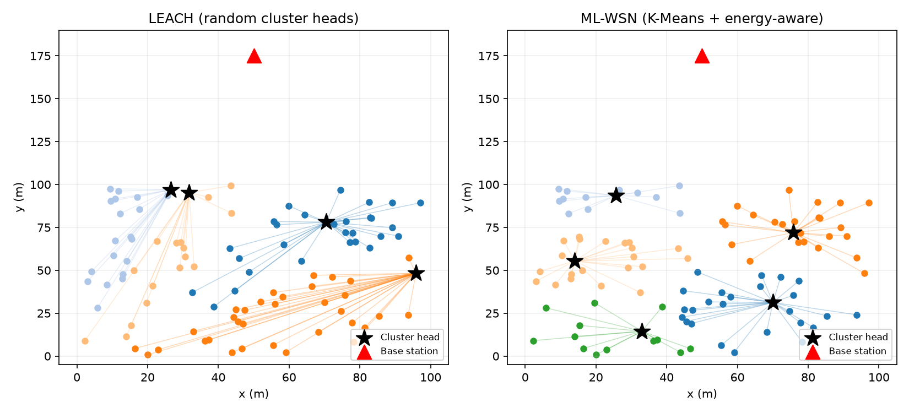

# Energy Efficient Routing in Wireless Sensor Networks Using ML

Wireless sensor nodes run on small batteries, so routing must save energy.
This project compares the classic **LEACH** protocol with an **ML-based protocol (ML-WSN)**
that uses **K-Means clustering** and **energy-aware cluster-head selection**.



## Approach
- 100 nodes randomly placed in a 100x100 m field, base station at (50, 175)
- First-order radio energy model (transmit, receive, aggregation costs)
- **LEACH (baseline):** cluster heads chosen randomly using a probability threshold
- **ML-WSN (proposed):** K-Means forms clusters of nearby nodes; in each cluster the node
  with the best score is the cluster head:
  `score = 0.6 * residual energy + 0.2 * closeness to base station + 0.2 * closeness to cluster centre`

## Project structure
```
wsn-ml-routing/
├── wsn_routing.py      # simulation, plots, multi-run experiment
├── app.py              # Streamlit interactive demo
├── requirements.txt
├── README.md
└── results/            # generated graphs and summary files
```

## How to run
```bash
git clone https://github.com/coolUser2006/wsn-ml-routing.git
cd wsn-ml-routing
pip install -r requirements.txt

python wsn_routing.py     # full experiment (single run + 10 random layouts)
streamlit run app.py      # interactive web demo
```
Set the number of random layouts with `WSN_RUNS` (Windows: `set WSN_RUNS=3` then run).

## Results

**Single run (seed 42)**

| Protocol | First node dead | Half nodes dead | Last node dead | Packets to BS |
|----------|-----------------|-----------------|----------------|---------------|
| LEACH    | 473             | 823             | 1252           | 4503          |
| ML-WSN   | 761             | 989             | 1149           | 4996          |

**Average over 10 random layouts (mean +/- std, rounds)**

| Protocol | First node dead | Half nodes dead | Last node dead | Packets to BS |
|----------|-----------------|-----------------|----------------|---------------|
| LEACH    | 516 +/- 41      | 835 +/- 17      | 1219 +/- 53    | 4411          |
| ML-WSN   | 730 +/- 31      | 976 +/- 14      | 1124 +/- 26    | 4898          |

ML-WSN keeps the full network alive about 41% longer on average (first node death) and delivers
more packets. Energy is spread evenly, so nodes die close together instead of one by one.
LEACH's last node survives slightly longer because it drains energy unevenly, leaving a few
nodes alive after the network has already lost coverage.

Graphs: `results/alive_nodes.png`, `residual_energy.png`, `packets_delivered.png`,
`lifetime_comparison.png`, `multi_run_lifetime.png`, `network_clusters.png`

## Tech stack
Python, NumPy, scikit-learn, Matplotlib, Streamlit

## Future work
- Q-learning based multi-hop routing
- Mobile base station / sink
- Heterogeneous node energy
- Comparison with HEED / SEP
